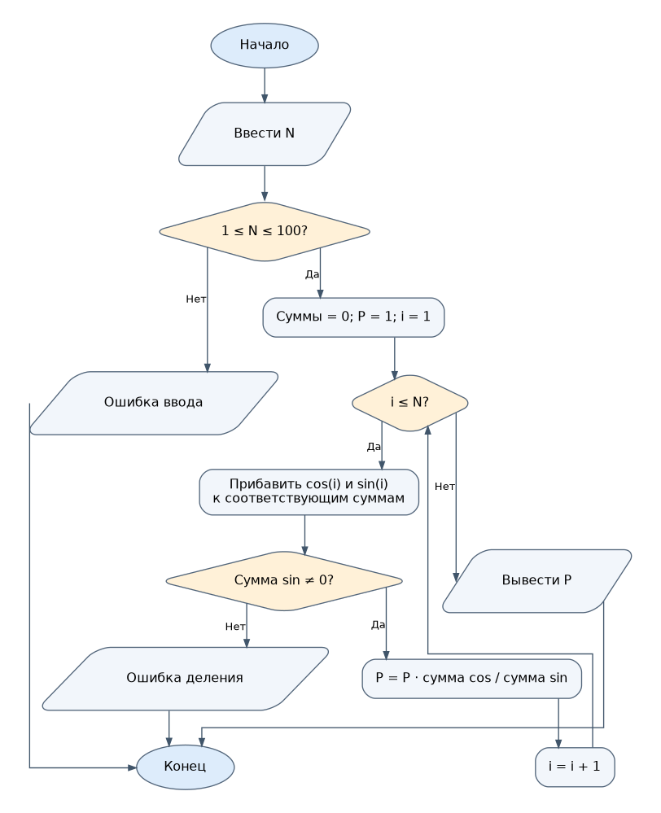

# Индивидуальное задание 3 — вариант 8

## Условие задачи

Для заданного целого положительного `N` вычислить с помощью цикла `for` произведение дробей:

`P = (cos(1)/sin(1)) · ((cos(1)+cos(2))/(sin(1)+sin(2))) · ... · ((cos(1)+...+cos(N))/(sin(1)+...+sin(N)))`.

Аргументы тригонометрических функций задаются **в радианах**.

## 1. Алгоритм и блок-схема

### Алгоритм

1. Начало программы.
2. Ввести число `N` и проверить допустимость значения.
3. Присвоить суммам синусов и косинусов `0`, произведению `1`.
4. В цикле `for` от `1` до `N` прибавлять `cos(i)` и `sin(i)` к соответствующим суммам.
5. Проверять знаменатель и умножать результат на отношение сумм.
6. Вывести произведение и завершить программу.

### Блок-схема



## 2. Реализация программы

Исходный код находится в файле [`Task3.c`](Task3.c).

```c
#define _CRT_SECURE_NO_WARNINGS
#include <stdio.h>
#include <math.h>
#include <windows.h>

int main(void)
{
    int n, i;
    double summa_cos = 0, summa_sin = 0, p = 1;
    SetConsoleOutputCP(65001);
    printf("Введите N (от 1 до 100): ");
    if (scanf("%d", &n) != 1 || n < 1 || n > 100) {
        printf("Ошибка ввода.\n");
        return 1;
    }
    for (i = 1; i <= n; i++) {
        summa_cos += cos((double)i);
        summa_sin += sin((double)i);
        if (fabs(summa_sin) < 1e-12) {
            printf("Ошибка: знаменатель близок к нулю.\n");
            return 1;
        }
        p *= summa_cos / summa_sin;
    }
    printf("Результат = %.6f\n", p);
    return 0;
}
```

## 3. Результат работы программы

Контрольные примеры (значения округлены до шести знаков):

```text
N = 1
Результат = 0.642093

N = 2
Результат = 0.045534
```

При `N = 0` программа сообщает об ошибке ввода.

## 4. Информация о разработчике

Жаворонков Богдан, бТИИ-262.
